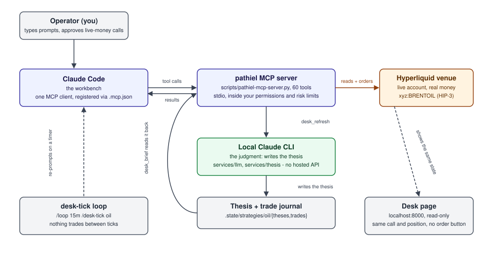
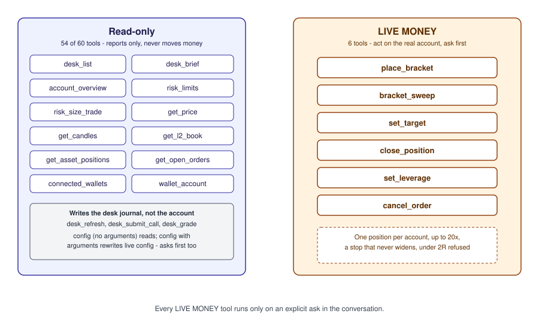
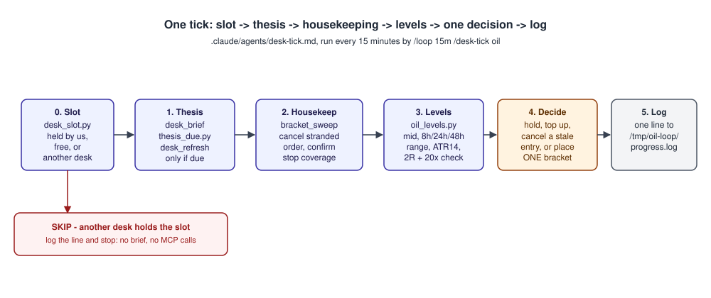

# Getting started with pathiel

pathiel is a headless trading desk on live Hyperliquid. Real money. There is
no autonomous bot and no standing process that trades on its own: Claude is
the only trader on the wallet, and it trades by calling the pathiel MCP
server from inside Claude Code.

This walkthrough gets you from a clean checkout to reading the oil desk's
call, sizing a trade, placing one bracket order, and shutting the whole
thing back down.

## 1. The problem this solves

A manual trader watches quotes, positions, open orders and stops across
several browser tabs. Nothing ties them together, so the easiest failure is
a naked position: a fill with no resting stop because a tab was closed or a
page was slow to load.

pathiel exists to make that failure structurally hard. Every order goes
through one path (`place_bracket`), every fill gets its own stop and target,
and `bracket_sweep` runs after every close to confirm the next position
can't go unprotected. One desk is active today: oil, trading Brent
(`xyz:BRENTOIL`, a HIP-3 perp on the xyz dex).

## 2. How the pieces fit together

| piece | what it does |
|---|---|
| **Claude Code** | the workbench. You type prompts here; it is the one MCP client talking to the server |
| **pathiel MCP server** | `scripts/pathiel-mcp-server.py`, 60 tools over stdio. Reads the venue and your account, places and manages orders, inside the permissions and risk limits you set |
| **Local Claude CLI** | the judgment. `services/llm` shells out to it to write the desk thesis (`services/thesis`); no hosted LLM API anywhere in the repo |
| **The desk-tick loop** | `.claude/skills/desk-tick/SKILL.md`, run on a schedule (`/loop 15m /desk-tick oil`). One tick: slot check, brief, sweep, levels, one decision, one log line |
| **The Desk page** | `python -m pathiel.server`, `http://localhost:8000/`. Reads the same call and position as the MCP tools. No order button lives there |



Figure 1. Claude Code calls the MCP server, which reads and trades on
Hyperliquid and triggers the local Claude CLI to write the thesis into the
desk journal. The desk-tick loop re-prompts Claude Code on a timer; the Desk
page reads the same state without a trading path of its own.

## 3. Setup

There are two ways to run pathiel. Pick one.

**Plugin install** (no checkout, no local web server; Hyperliquid's own app
is your dashboard):

```
/plugin install pathiel --marketplace Julian-dev28/pathiel
/pathiel:setup
```

`/pathiel:setup` builds a private Python environment, creates
`~/.pathiel/.env.local` from `.env.local.example` for you to fill in, checks
the keys with `scripts/preflight_secrets.py` without printing them, and
walks you through connecting the MCP server (`commands/setup.md`).

**Repo checkout** (adds the Desk page):

```bash
git clone https://github.com/Julian-dev28/pathiel
cd pathiel
cp .env.local.example .env.local
```

### Keys

One file holds credentials: `.env.local` in a checkout, `~/.pathiel/.env.local`
for a plugin install (mode 0600, gitignored either way). Precedence:
`PATHIEL_ENV_FILE`, then the checkout's `.env.local`, then
`~/.pathiel/.env.local`.

Names only, never values, in this doc or anywhere else:

- `HYPERLIQUID_WALLET_ADDRESS`, `HYPERLIQUID_PRIVATE_KEY`: an **agent
  wallet**, created in the Hyperliquid UI under *More, API*, approved by
  your master account (`approveAgent`). An agent wallet can trade; it can
  never withdraw.
- `HYPERLIQUID_MASTER_ADDRESS`: the account the agent wallet acts for. A
  public address, not a secret, but still required: pathiel refuses to
  start if the trading key and the master key are the same key.
- `EIA_API_KEY`, `FRED_API_KEY`, `CONGRESS_API_KEY`: optional, free, each
  one feeds `services/intel`; a missing key just skips that source. Run
  `scripts/intel_keys.py` to see which are set.

Never put the master account's own private key anywhere pathiel reads it.
`HYPERLIQUID_MASTER_PRIVATE_KEY` exists only for `scripts/treasury.py`, run
by hand on your own machine, never on a trading key path.

### Connect

In Claude Code, run `/mcp` and confirm the `pathiel` server shows connected
with 60 tools. If it doesn't, the error is in the MCP panel; the usual cause
for a plugin install is step 1 of `/pathiel:setup` not finishing.

### First read-only checks

```
desk_list
```
Every desk's one-line card: tagline, coin, mid, latest call. Confirms the
server can read the venue.

```
account_overview
```
Your account's equity, where it sits across dexes, open positions, and
whether it can trade right now.

Both are plain reads. Neither touches the account.

## 4. Permissions and safety

Of pathiel's 60 MCP tools, 6 are LIVE MONEY: `place_bracket`,
`bracket_sweep`, `set_target`, `close_position`, `set_leverage`,
`cancel_order`. The MCP server marks every one of them `destructiveHint`,
so an MCP client asks before each call, and the server's own instructions
say the same thing in words: call them only when you asked for that exact
action in this conversation. `config` with arguments is a seventh case,
rewriting the live trading config, and asks the same way. Everything else
only reads the venue, your account or the desk journal; `desk_refresh`,
`desk_submit_call` and `desk_grade` write the desk's thesis/trade journal
but never place or touch an order.



Figure 2. 54 of 60 tools only read. 6 act on the real account and are
marked LIVE MONEY; a client asks before every one of them.

The hard rules `place_bracket` and the desk-tick agent enforce, as the repo
states them:

- **One position per account.** `.agent-config.json`'s `max_open_positions`
  is 1; `place_bracket` refuses to stack a second position or resting order
  on the same coin.
- **The whole equity, every position.** Sizing holds back nothing but the
  opening taker fee (`services/risk/derive.py::margin_after_open_fee`).
- **The stop never widens.** No breakeven, no trail: backtested
  2026-10-28, the fixed stop beat every moving-stop rule tried
  (`docs/strategy/OIL_STRATEGY.md`).
- **The 2R gate.** `place_bracket` refuses any bracket paying under 2R to
  its target (`bracket.DEFAULT_MIN_R`).
- **The 20x rule.** Leverage up to the risk profile's `max_leverage` (20x);
  the stop must sit inside half the distance to liquidation, or the tool
  refuses.
- **Never chase.** No entry above a long thesis's entry (below it for a
  short).

## 5. Walkthrough: from reading the market to placing and tracking a trade

Read-only first. Each prompt below is something you type to Claude Code once
`pathiel` shows connected in `/mcp`.

**Check the account**

```
account_overview
```
Returns equity, where it sits (main dex plus any HIP-3 dex holding margin),
open positions, and whether the account can trade. Read-only.

**Read the oil call**

```
desk_brief {desk: "oil"}
```
Quick mode: a short markdown call, direction, entry, stop, target, the R
it pays, plus "Your size" for your account. Read-only.

**Check levels**

```bash
python3 scripts/oil_levels.py --coin xyz:BRENTOIL
```
Mid, the last closed 1h candle, 8h/24h/48h range, ATR14, and the 15m micro
range. Read-only; no key, no account, a public Hyperliquid candle read.

**Size a trade**

```
risk_size_trade {coin: "xyz:BRENTOIL", entry_px: <price>, stop_px: <price>}
```
Sizes one trade for your account under your saved risk profile: size,
margin, dollars at risk, payoff, liquidation price. Read-only: use this
before suggesting any size, never arithmetic by hand.

**Dry-run a bracket**

```
place_bracket {coin: "xyz:BRENTOIL", stop_px: <price>, tp_px: <price>, dry_run: true}
```
Judges the trade (2R or better, the 20x line) and reports the size it would
use, without sending anything to the venue. Omit `entry_px` for a market
entry at the live mid.

**Place it, LIVE MONEY, ask for this explicitly**

```
place_bracket {coin: "xyz:BRENTOIL", stop_px: <price>, tp_px: <price>}
```
Same call without `dry_run`. One entry with an exact stop and target, sized
to your account, refused under 2R or a taken slot. This sends a real order
to Hyperliquid. Only ask for it when you mean it.

**Sweep after a close**

```
bracket_sweep {coin: "xyz:BRENTOIL"}
```
LIVE MONEY. Cancels a stranded sibling order left by a fired stop or
target, confirms a remaining position is covered by a stop, and folds
one-per-fill stops or targets at one price into a single order. Run it
after every close.

**Move a target**

```
set_target {coin: "xyz:BRENTOIL", tp_px: <price>}
```
LIVE MONEY. Moves an open position's take-profit: the new limit target goes
on first, then the old one is cancelled. Refuses a target on the losing
side of the mark. Never touches the stop.

**Start the 15m loop**

```
/loop 15m /desk-tick oil
```
Runs one desk-tick every 15 minutes for the rest of this Claude Code
session. Nothing trades between ticks, and nothing trades at all once the
session stops.

**Read the loop log**

```bash
tail -f /tmp/oil-loop/progress.log
```
One line per tick: coin, mid, position, the action taken (`HOLD`,
`PLACED`, `CANCELLED`, `CLOSED`, `NONE`), and why.

## 6. One tick, step by step

Each tick runs the procedure in `.claude/agents/desk-tick.md`, launched by
`.claude/skills/desk-tick/SKILL.md` on the `/loop` schedule.



Figure 3. Slot, thesis, housekeeping, levels, one decision, one log line.
A slot held by another desk skips everything after the first step.

0. **Slot.** `scripts/desk_slot.py` says whether the account's one position
   slot is free, held by this desk, or held by another desk's coin. Held by
   another desk: log `SKIP`, stop. No brief, no levels, no MCP calls.
1. **Thesis.** `desk_brief {desk: "oil"}` for the current call.
   `scripts/thesis_due.py` says whether the thesis needs a rewrite (once a
   day, after an API/EIA/OPEC release it listed, after a position closes,
   or a 1.5% move since it was written); `desk_refresh` runs only when it
   says `due: true`.
2. **Housekeeping.** `bracket_sweep {coin: "xyz:BRENTOIL"}`: cancel a
   stranded sibling order, confirm stop coverage on any open position.
3. **Levels.** `scripts/oil_levels.py`: mid, closed 1h candle, 8h/24h/48h
   range, ATR14, the 15m micro range; `--check` judges one level against
   the 2R gate and the 20x line.
4. **Decide.** Exactly one of: hold, top up an existing position at the
   thesis entry, cancel a resting entry that no longer passes, or place one
   new market bracket off the 24h range when price pays 2R. No setup, no
   trade.
5. **Log.** One line appended to `/tmp/oil-loop/progress.log`.

## 7. Disconnecting

**Stop the loop.** The loop only runs while a Claude Code session is
executing it (`/loop 15m /desk-tick oil`); end or interrupt that session and
nothing trades between ticks, because nothing ticks at all.

**Revoke the agent wallet.** In the Hyperliquid UI, *More, API*, revoke the
agent wallet pathiel trades with. This alone stops every future order: an
agent key can never withdraw, so the exposure was always bounded to open
positions (`docs/SECRETS.md`). Close any open position first if you want it
flat before you revoke.

**Remove the local key.** Delete or empty `.env.local` (checkout) or
`~/.pathiel/.env.local` (plugin install) if you don't plan to reconnect.

**Stop the dashboard**, if you were running the checkout's Desk page:

```bash
scripts/restart.sh stop
```

## 8. Where to go next

- [`docs/strategy/OIL_STRATEGY.md`](strategy/OIL_STRATEGY.md): the oil
  desk's entry, stop and target rules, and the backtests behind them.
- [`docs/overhaul/MCP.md`](overhaul/MCP.md): the full 60-tool table,
  regenerated from the server's own tool list.
- [`README.md`](../README.md): desks, risk profile, dashboard, security,
  and how to run the gate suite.
