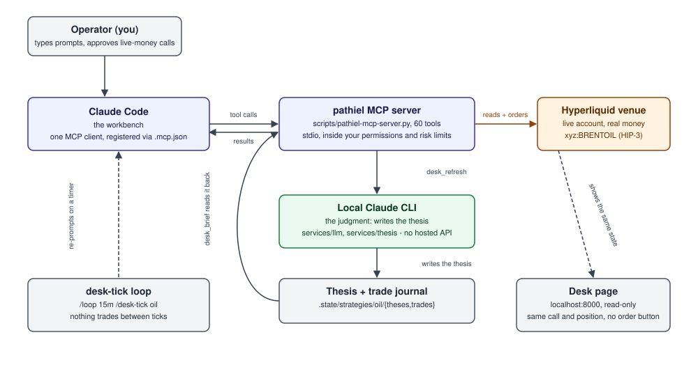
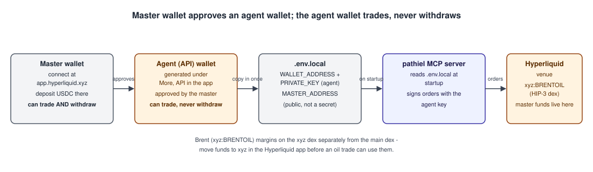
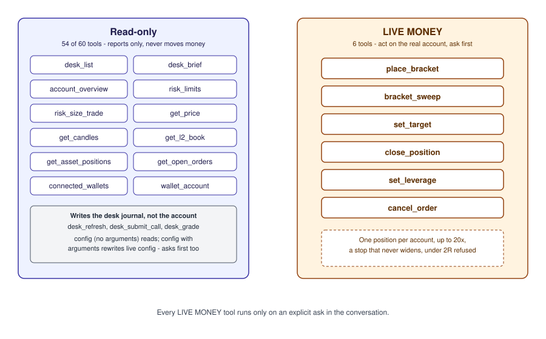
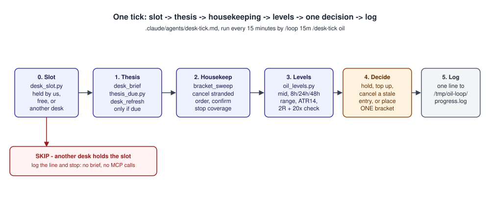

# Getting started with pathiel

pathiel is a headless trading desk on Hyperliquid. There is no autonomous
bot and no standing process that trades on its own: Claude is the only
trader on the wallet, and it trades by calling the pathiel MCP server from
inside Claude Code. A plugin install runs on Hyperliquid mainnet: read-only
until you add a key, real money after that. Testnet is a one-line opt-in.

This walkthrough gets you from a fresh install to reading the oil desk's
call, sizing a trade, placing one bracket order, and shutting the whole
thing back down. Read the "Before you trade" section of the
[README](../README.md) first: it covers the networks, the builder fee, the
risks and the restricted jurisdictions.

## 1. The problem this solves

A manual trader watches quotes, positions, open orders and stops across
several browser tabs. Nothing ties them together, so the easiest failure is
a naked position: a fill with no resting stop because a tab was closed or a
page was slow to load.

pathiel exists to make that failure structurally hard. Every order goes
through one path (`place_bracket`), every fill gets its own stop and target,
and `bracket_sweep` runs after every close to confirm the next position
can't go unprotected. One desk is active on a fresh install: oil, trading
Brent (`xyz:BRENTOIL`, a HIP-3 perp on the xyz dex) on mainnet. Brent is not
listed on testnet, so there the oil desk trades WTI (`xyz:CL`) instead.

## 2. How the pieces fit together

| piece | what it does |
|---|---|
| **Claude Code** | the workbench. You type prompts here; it is the one MCP client talking to the server |
| **pathiel MCP server** | `scripts/pathiel-mcp-server.py`, 60 tools over stdio. Reads the venue and your account, places and manages orders, inside the permissions and risk limits you set |
| **Local Claude CLI** | the judgment. `services/llm` shells out to it to write the desk thesis (`services/thesis`); no hosted LLM API anywhere in the repo |
| **The desk-tick loop** | `skills/desk-tick/SKILL.md`, the plugin's `/pathiel:desk-tick` skill, run on a schedule (`/loop 15m /pathiel:desk-tick oil`). One tick: slot check, brief, sweep, levels, one decision, one log line |
| **The Desk page** | `python -m pathiel.server`, `http://localhost:8000/`. Reads the same call and position as the MCP tools. No order button lives there |



Figure 1. Claude Code calls the MCP server, which reads and trades on
Hyperliquid and triggers the local Claude CLI to write the thesis into the
desk journal. The desk-tick loop re-prompts Claude Code on a timer; the Desk
page reads the same state without a trading path of its own.

## 3. Setup

**Plugin install** (the public path: no checkout, no local web server;
Hyperliquid's own app is your dashboard):

```
/plugin marketplace add Julian-dev28/pathiel
/plugin install pathiel@pathiel
/pathiel:setup
```

From a shell instead:

```bash
claude plugin marketplace add Julian-dev28/pathiel
claude plugin install pathiel@pathiel
```

Claude Code v2.1.275 or later also takes
`/plugin install pathiel --marketplace Julian-dev28/pathiel` as one step. If
it asks you to run `/reload-plugins`, do that first.

Run `/pathiel:setup` and follow it; the steps are in `commands/setup.md`.
It builds a private Python environment, creates `~/.pathiel/.env.local`
and a safe starting config (at most 3x, 1% of equity at the stop, one
position), checks the keys without printing them, shows the risks, and
connects the MCP server.

- **Mainnet by default.** With a key, every order is real money on
  Hyperliquid mainnet.
- **No key, read-only.** Without a key every read tool works on mainnet
  data and every write tool answers that no key is configured.
- **Testnet is an opt-in.** Add `PATHIEL_NETWORK=testnet` to
  `~/.pathiel/.env.local` and reconnect pathiel in `/mcp`. Testnet needs
  its own API wallet, created and approved in the testnet app
  (app.hyperliquid-testnet.xyz), with test funds. Testnet and mainnet keep
  separate state. On testnet the oil desk trades WTI (`xyz:CL`); swap it in
  for `xyz:BRENTOIL` in the prompts below.
- **Builder fee.** None: pathiel charges no fee and its orders carry no
  builder fee. [BUILDER_FEE.md](BUILDER_FEE.md) has the details, and how to
  revoke an approval you gave pathiel 0.4.0.

Other MCP clients use the launcher `scripts/pathiel-mcp` or the container,
both described in the README.

**Maintainer checkout** (adds the Desk page; this is the maintainer's own
setup, not the public one):

> Maintainer path: this runs mainnet with the tracked repo config (20x, whole-equity sizing). It is not the public install.

```bash
git clone https://github.com/Julian-dev28/pathiel
cd pathiel
cp .env.local.example .env.local
```

### Connect your Hyperliquid account

pathiel trades on your own Hyperliquid account. Reading markets needs no
account at all. Before it can trade, you need an account with funds on it
and a separate key pathiel is allowed to sign orders with.

**The quick way, on a plugin install: connect your wallet.** Fund the
account first (steps 1 and 2 below), then run `/pathiel:setup` and pick
"Connect your wallet", or ask Claude to connect your wallet. Claude calls
`wallet_connect`, which:

- makes a new API wallet (agent) key on your machine,
- opens a one-time local page (`http://127.0.0.1:<port>/...`, ten minutes)
  that shows the network, MAINNET in red, and the new API wallet's
  address,
- asks your browser wallet (MetaMask, Rabby, Coinbase Wallet or any other)
  for one signature: Hyperliquid's `approveAgent` for that address,
- sends the approval to Hyperliquid, checks that Hyperliquid lists the new
  API wallet for your account, and only then writes
  `HYPERLIQUID_PRIVATE_KEY`, `HYPERLIQUID_WALLET_ADDRESS` and
  `HYPERLIQUID_MASTER_ADDRESS` into `~/.pathiel/.env.local` (mode 0600,
  your other lines kept).

The key can trade and never withdraw, it never leaves your machine, and
your main key never leaves your wallet. On testnet, add
`PATHIEL_NETWORK=testnet` to the env file and reconnect pathiel in `/mcp`
before you connect, so the approval is signed for testnet. When it says
done, reconnect pathiel in `/mcp` so the server loads the key. Claude can
also run the same flow as a script, `scripts/connect_wallet.py`:

```bash
"${CLAUDE_PLUGIN_ROOT}/scripts/pathiel-py" scripts/connect_wallet.py
```

**By hand.** Five steps, done once per network: on testnet, do each step
in the testnet app instead. A checkout (the maintainer path) always uses
these.

1. **Connect your Hyperliquid account.** Go to app.hyperliquid.xyz and
   connect a wallet; this becomes your master account, the one that holds
   your funds. Deposit USDC in the Hyperliquid app.
2. **Fund the dex oil trades on.** Brent (`xyz:BRENTOIL`) is a HIP-3 perp
   on the xyz dex, and each HIP-3 dex margins separately from the main
   dex: money on xyz only backs xyz:\* trades. Move funds to xyz in the
   Hyperliquid app before an oil trade can use them, or `account_overview`
   will show equity sitting on the wrong dex and the trade will be
   refused.
3. **Create the agent (API) wallet.** In the Hyperliquid app, go to *More,
   API*, and generate a new API wallet, then approve it from your master
   account (`approveAgent`). Copy its address and private key before you
   leave that screen. This is the key pathiel actually signs orders with:
   an agent wallet can trade but can never withdraw. A leaked agent key
   could still lose money by trading, but it can never move funds out;
   revoke it in the app and the leak is closed.
4. **Put the credentials in the env file.** One file holds them: `.env.local`
   in a checkout, `~/.pathiel/.env.local` for a plugin install (mode 0600,
   gitignored either way). Precedence: `PATHIEL_ENV_FILE`, then the
   checkout's `.env.local`, then `~/.pathiel/.env.local`. A checkout starts
   this file with `cp .env.local.example .env.local`; a plugin install gets
   it from `/pathiel:setup`. Fill in the **agent** wallet's address and key,
   plus the master account's public address:

   ```
   HYPERLIQUID_WALLET_ADDRESS=0xYOUR_AGENT_WALLET_ADDRESS
   HYPERLIQUID_PRIVATE_KEY=0xYOUR_AGENT_WALLET_PRIVATE_KEY
   HYPERLIQUID_MASTER_ADDRESS=0xYOUR_MASTER_ACCOUNT_ADDRESS
   ```

   Never put the master account's own private key anywhere pathiel reads
   it. `HYPERLIQUID_MASTER_PRIVATE_KEY` exists only for
   `scripts/treasury.py`, run by hand on your own machine, never on a
   trading key path. `EIA_API_KEY`, `FRED_API_KEY`, `CONGRESS_API_KEY` are
   optional, free, and each feeds `services/intel`; a missing one just
   skips that source. Run `scripts/intel_keys.py` to see which are set.
5. **Check it, without printing anything.**

   ```bash
   .venv/bin/python scripts/preflight_secrets.py
   ```

   Every line must read PASS or WARN; a FAIL names the variable to fix. A
   plugin install's `/pathiel:setup` already runs this check for you. Then
   run `/mcp` and read `account_overview` (both covered next) to confirm
   the account and the xyz equity show up.



Figure 2. The master wallet holds the funds and approves an agent wallet
that can trade but never withdraw. The agent's address and key go in
`.env.local`; the pathiel MCP server reads that file and signs orders with
the agent key against Hyperliquid, where the master account's funds sit.

### Connect

In Claude Code, run `/mcp` and confirm the `pathiel` server shows connected
with 30 tools on a plugin install (60 in a checkout). If it doesn't, the error is in the MCP panel; the usual cause
for a plugin install is step 1 of `/pathiel:setup` not finishing.

### First read-only checks

```
desk_list
```
Every desk's one-line card: tagline, coin, mid, latest call. Confirms the
server can read the venue.

```
account_overview
```
Your account's equity, where it sits across dexes, open positions, and
whether it can trade right now.

Both are plain reads. Neither touches the account.

## 4. Starter prompts

Plain English, not tool-call syntax. Paste any of these into Claude Code
once `pathiel` shows connected in `/mcp`; the line under each one names the
real tool or file that answers it.

### Look around (read-only)

**Check your balance**

```
What's my account balance and do I have any open positions?
```
`account_overview`: equity, where it sits, open positions, whether the
account can trade right now.

**Read the oil call**

```
What's the oil desk's current call, and how much would I size it at?
```
`desk_brief {desk: "oil"}`: direction, entry, stop, target, the R it pays,
plus "Your size" for this account.

**Check the range**

```
Show me Brent's 24h range and where price sits in it.
```
Claude runs the levels script, `scripts/oil_levels.py`: mid, the last
closed 1h candle, 8h/24h/48h range, ATR14, the 15m micro range.

**Check your limits**

```
What are my risk limits?
```
`risk_limits`: positions at once, dollars lost per stop-out, the daily loss
figure (shown, not enforced), max leverage.

### Understand the strategy (read-only)

**Entry rules in plain English**

```
Explain the oil desk's entry rules in plain English.
```
No tool call. Claude reads [docs/strategy/OIL_RULES.md](strategy/OIL_RULES.md)
and the current call from `desk_brief`.

**Why the last tick held**

```
Why didn't the last tick take a trade?
```
Claude reads the tick's own log line in `/tmp/oil-loop/progress.log`, then
`desk_brief {desk: "oil"}` for the call it was judged against.

**What 2R means right now**

```
What does 2R mean for the trade on the table right now?
```
No tool call. Claude explains `desk_brief`'s R number against the 2R gate
described in [docs/strategy/OIL_RULES.md](strategy/OIL_RULES.md).

### Plan a trade (read-only)

**Size it first**

```
Size this trade for my account before I commit to anything.
```
`risk_size_trade {coin: "xyz:BRENTOIL", entry_px: <price>, stop_px: <price>}`:
size, margin, dollars at risk, payoff, liquidation price.

**Dry-run a bracket**

```
Dry-run a bracket for the current oil setup and tell me if it passes the
2R gate and the liquidation rule.
```
`place_bracket {coin: "xyz:BRENTOIL", stop_px: <price>, tp_px: <price>, dry_run: true}`:
judges the trade and reports the size it would use, without sending
anything to the venue.

### Act (LIVE MONEY, only when you mean it)

**Place it**

```
Place the oil bracket you just dry-ran.
```
LIVE MONEY. The same `place_bracket` call without `dry_run`: sends a real
order to Hyperliquid.

**Move the target**

```
Move my Brent target to <price>.
```
LIVE MONEY. `set_target {coin: "xyz:BRENTOIL", tp_px: <price>}`: moves the
open position's take-profit. Never touches the stop.

**Sweep after a close**

```
Sweep Brent after that close.
```
LIVE MONEY. `bracket_sweep {coin: "xyz:BRENTOIL"}`: cancels a stranded
sibling order and confirms the open position is covered by a stop.

### Run the loop

**Start it**

```
/loop 15m /pathiel:desk-tick oil
```
Runs one desk-tick every 15 minutes for the rest of this Claude Code
session.

**Stop it**

```
Stop the loop.
```
Claude cancels the scheduled `/loop` job in this session; ending the
session stops it too. The loop has no process of its own, so once it is
cancelled nothing ticks and nothing trades.

## 5. Permissions and safety

Of pathiel's 60 MCP tools, 6 are LIVE MONEY: `place_bracket`,
`bracket_sweep`, `set_target`, `close_position`, `set_leverage`,
`cancel_order`. The MCP server marks every one of them `destructiveHint`
(a client that honors the hint asks before each call), and the server's own
instructions say the same thing in words: call them only when you asked for that exact
action in this conversation. `config` with arguments is a seventh case,
rewriting the live trading config, and asks the same way. Everything else
only reads the venue, your account or the desk journal; `desk_refresh`,
`desk_submit_call` and `desk_grade` write the desk's thesis/trade journal
but never place or touch an order.



Figure 3. 54 of 60 tools only read. 6 act on the real account and are
marked LIVE MONEY; a client asks before every one of them.

The hard rules `place_bracket` and the desk-tick agent enforce, as the repo
states them:

- **One position per account.** `.agent-config.json`'s `max_open_positions`
  is 1; `place_bracket` refuses to stack a second position or resting order
  on the same coin.
- **Size comes from your risk profile.** A public install risks 1% of
  equity at the stop. The maintainer's tracked config sizes with the whole
  equity, holding back nothing but the opening taker fee
  (`services/risk/derive.py::margin_after_open_fee`).
- **The stop never moves.** No breakeven, no trail: once placed, a stop
  stays where it is until it fills or the position closes
  (`docs/strategy/OIL_RULES.md`).
- **The 2R gate.** `place_bracket` refuses any bracket paying under 2R to
  its target (`bracket.DEFAULT_MIN_R`).
- **The liquidation rule.** Leverage up to the risk profile's `max_leverage` (3x
  on a public install, 20x in the maintainer's config); the stop must sit
  inside half the distance to liquidation, or the tool refuses.
- **Never chase.** No entry above a long thesis's entry (below it for a
  short).

## 6. Walkthrough: from reading the market to placing and tracking a trade

Read-only first. Each prompt below is something you type to Claude Code once
`pathiel` shows connected in `/mcp`.

**Check the account**

```
account_overview
```
Returns equity, where it sits (main dex plus any HIP-3 dex holding margin),
open positions, and whether the account can trade. Read-only.

**Read the oil call**

```
desk_brief {desk: "oil"}
```
Quick mode: a short markdown call, direction, entry, stop, target, the R
it pays, plus "Your size" for your account. Read-only.

**Check levels**

```bash
python3 scripts/oil_levels.py --coin xyz:BRENTOIL
```
Mid, the last closed 1h candle, 8h/24h/48h range, ATR14, and the 15m micro
range. Read-only; no key, no account, a public Hyperliquid candle read.

**Size a trade**

```
risk_size_trade {coin: "xyz:BRENTOIL", entry_px: <price>, stop_px: <price>}
```
Sizes one trade for your account under your saved risk profile: size,
margin, dollars at risk, payoff, liquidation price. Read-only: use this
before suggesting any size, never arithmetic by hand.

**Dry-run a bracket**

```
place_bracket {coin: "xyz:BRENTOIL", stop_px: <price>, tp_px: <price>, dry_run: true}
```
Judges the trade (2R or better, the stop inside half the distance to
liquidation) and reports the size it would
use, without sending anything to the venue. Omit `entry_px` for a market
entry at the live mid.

**Place it, LIVE MONEY, ask for this explicitly**

```
place_bracket {coin: "xyz:BRENTOIL", stop_px: <price>, tp_px: <price>}
```
Same call without `dry_run`. One entry with an exact stop and target, sized
to your account, refused under 2R or a taken slot. This sends a real order
to Hyperliquid. Only ask for it when you mean it.

**Sweep after a close**

```
bracket_sweep {coin: "xyz:BRENTOIL"}
```
LIVE MONEY. Cancels a stranded sibling order left by a fired stop or
target, confirms a remaining position is covered by a stop, and folds
one-per-fill stops or targets at one price into a single order. Run it
after every close.

**Move a target**

```
set_target {coin: "xyz:BRENTOIL", tp_px: <price>}
```
LIVE MONEY. Moves an open position's take-profit: the new limit target goes
on first, then the old one is cancelled. Refuses a target on the losing
side of the mark. Never touches the stop.

**Start the 15m loop**

```
/loop 15m /pathiel:desk-tick oil
```
Runs one desk-tick every 15 minutes for the rest of this Claude Code
session. Nothing trades between ticks, and nothing trades at all once the
session stops.

**Read the loop log**

```bash
tail -f /tmp/oil-loop/progress.log
```
One line per tick: coin, mid, position, the action taken (`HOLD`,
`PLACED`, `CANCELLED`, `CLOSED`, `NONE`), and why.

## 7. One tick, step by step

Each tick runs the procedure in `agents/desk-tick.md`, launched by
`skills/desk-tick/SKILL.md` on the `/loop` schedule (the maintainer's
checkout runs the project copies under `.claude/`).



Figure 4. Slot, thesis, housekeeping, levels, one decision, one log line.
A slot held by another desk skips everything after the first step.

0. **Slot.** `scripts/desk_slot.py` says whether the account's one position
   slot is free, held by this desk, or held by another desk's coin. Held by
   another desk: log `SKIP`, stop. No brief, no levels, no MCP calls.
1. **Thesis.** `desk_brief {desk: "oil"}` for the current call.
   `scripts/thesis_due.py` says whether the thesis needs a rewrite (once a
   day, after an API/EIA/OPEC release it listed, after a position closes,
   or a 1.5% move since it was written); `desk_refresh` runs only when it
   says `due: true`.
2. **Housekeeping.** `bracket_sweep {coin: "xyz:BRENTOIL"}`: cancel a
   stranded sibling order, confirm stop coverage on any open position.
3. **Levels.** `scripts/oil_levels.py`: mid, closed 1h candle, 8h/24h/48h
   range, ATR14, the 15m micro range; `--check` judges one level against
   the 2R gate and the liquidation line.
4. **Decide.** Exactly one of: hold, top up an existing position at the
   thesis entry, cancel a resting entry that no longer passes, or place one
   new market bracket off the 24h range when price pays 2R. No setup, no
   trade.
5. **Log.** One line appended to `/tmp/oil-loop/progress.log`.

## 8. Disconnecting

**Stop the loop.** The loop only runs while a Claude Code session is
executing it (`/loop 15m /pathiel:desk-tick oil`); end or interrupt that session and
nothing trades between ticks, because nothing ticks at all.

**Revoke the agent wallet.** In the Hyperliquid UI, *More, API*, revoke the
agent wallet pathiel trades with. This alone stops every future order: an
agent key can never withdraw, so the exposure was always bounded to open
positions (`docs/SECRETS.md`). Close any open position first if you want it
flat before you revoke.

**Remove the local key.** Delete or empty `.env.local` (checkout) or
`~/.pathiel/.env.local` (plugin install) if you don't plan to reconnect.

**Stop the dashboard**, if you were running the checkout's Desk page:

```bash
scripts/restart.sh stop
```

## 9. Where to go next

- [`docs/strategy/OIL_RULES.md`](strategy/OIL_RULES.md): the oil desk's
  entry, stop and target rules, and what is not known about them.
- [`docs/overhaul/MCP.md`](overhaul/MCP.md): the full 60-tool table,
  regenerated from the server's own tool list.
- [`README.md`](../README.md): install, safety, the builder fee, the FAQ,
  and the maintainer setup.
- [`SECURITY.md`](../SECURITY.md): where keys live and what pathiel never
  does.
